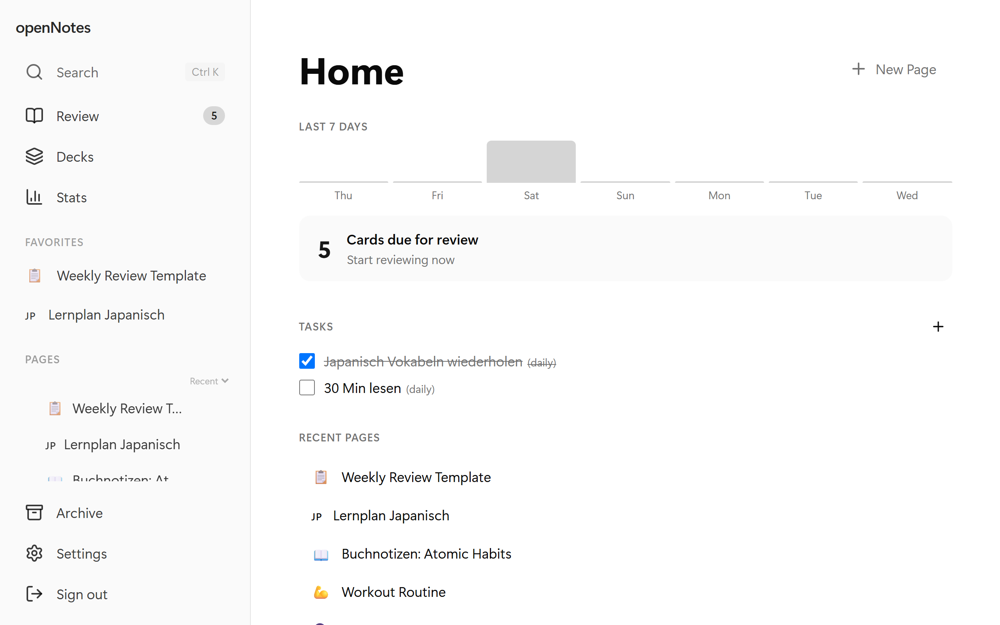
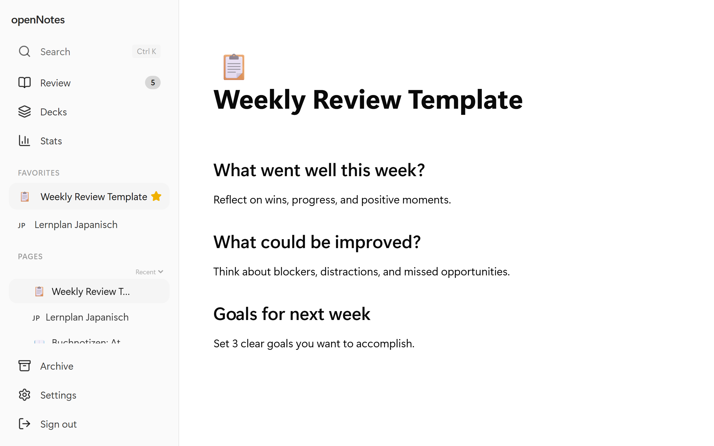
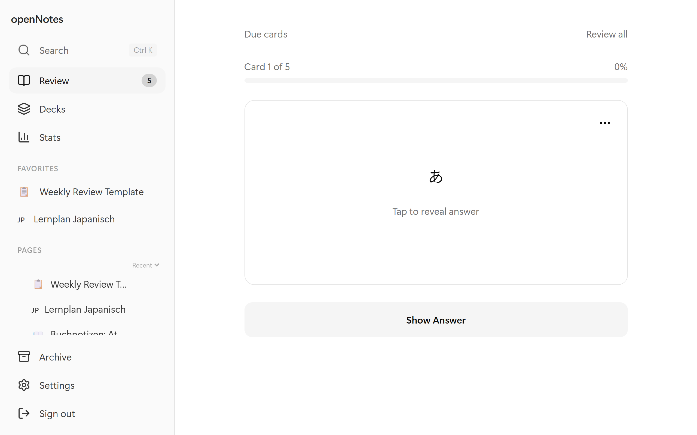
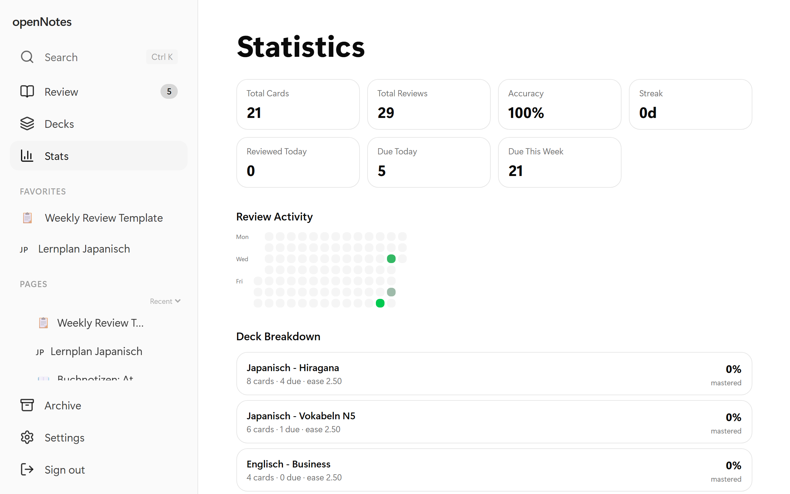
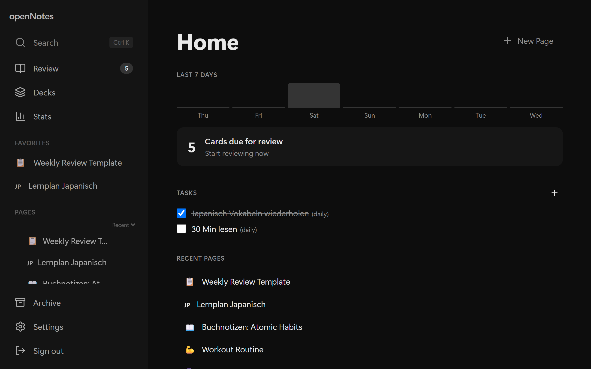

<div align="center">

# openNotes

**Open-source personal knowledge base with Notion-like pages and Anki-like spaced repetition flashcards.**

Self-hosted. Offline-ready. Open source.

[](https://github.com/erdinc61/openNotes/stargazers)
[](LICENSE)
[](https://github.com/erdinc61/openNotes/commits/master)
[](https://github.com/erdinc61/openNotes)

</div>

---

<div align="center">

<picture>
  <source media="(prefers-color-scheme: dark)" srcset="assets/readme/dashboard-dark.png">
  <source media="(prefers-color-scheme: light)" srcset="assets/readme/dashboard-light.png">
  
</picture>

</div>

## Why openNotes?

Most note-taking and flashcard apps lock you into their cloud or charge monthly fees. openNotes gives you:

- **Your data, your server** — everything lives in a single SQLite file you can backup, move, or inspect
- **Notion-like pages** — rich text editor with slash commands, nested pages, cover images
- **Anki-like flashcards** — SM-2 spaced repetition that actually works
- **Zero cost** — free and open source

---

## Features

### Pages

<div align="center">

</div>

<br>

- **Rich text editor** — bold, italic, headings, quotes, code blocks, dividers
- **Slash commands** — type `/` for quick block insertion
- **Nested pages** — tree structure with breadcrumb navigation
- **Cover images & page icons** — upload covers, pick emoji icons
- **Tables, task lists, images** — paste from clipboard, click to zoom
- **Markdown export** — export any page as `.md`
- **Favorites, search (`Ctrl+K`), archive**

### Flashcards

<div align="center">

</div>

<br>

- **SM-2 algorithm** — Again / Hard / Good / Easy scheduling
- **Decks** with due-count badges
- **Create from selection** — highlight text, create a card instantly
- **Image cards** — images on front and back
- **Review due cards** or review all in a deck

### Statistics

<div align="center">

</div>

<br>

- **Review heatmap** — GitHub-style 90-day activity grid
- **Summary cards** — total cards, reviews, accuracy, streak
- **Deck breakdown** — per-deck mastery and ease factor

### More

- **Daily tasks** — recurring tasks on the home screen, 7-day chart
- **Dark mode** — light & dark themes, UI scaling (75%--150%)
- **PWA** — install as app on mobile
- **Keyboard shortcuts** — press `?` to view all

<div align="center">

</div>

---

## Quick Start

```bash
git clone https://github.com/erdinc61/openNotes.git
cd openNotes
export BETTER_AUTH_SECRET=$(openssl rand -base64 32)
docker compose up -d
```

Open `http://localhost:3000`, create an account, done.

> [!NOTE]
> `BETTER_AUTH_SECRET` is required for auth. Without it, login will fail.

Everything is stored in a single SQLite file, persisted via the `opennotes-data` Docker volume.

**Without Docker:**

```bash
npm install && npx drizzle-kit push && npm run dev
```

---

## Tech Stack

| Layer | Technology |
|---|---|
| Framework | [Next.js 16](https://nextjs.org) (App Router, Server Actions) |
| Editor | [Tiptap](https://tiptap.dev) (ProseMirror-based) |
| Database | [SQLite](https://sqlite.org) via [better-sqlite3](https://github.com/WiseLibs/better-sqlite3) |
| ORM | [Drizzle ORM](https://orm.drizzle.team) |
| Auth | [Better Auth](https://www.better-auth.com) |
| Styling | [Tailwind CSS v4](https://tailwindcss.com) + [shadcn/ui](https://ui.shadcn.com) |
| Algorithm | SM-2 spaced repetition |

---

## License

MIT — see [LICENSE](LICENSE) for details.
